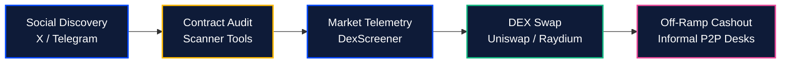

# The Web3 Operational Dilemma

[← Back to Overview](../README.md) | [Next: The Unified Super-Terminal →](02-the-unified-super-terminal.md)

---

## 1. The High-Velocity Friction Problem

Crypto participants operate in an inherently high-velocity, high-risk market. In modern decentralized finance, discovering an emerging token, validating its legitimacy, executing an order, and cashing out yields requires navigating a fragmented labyrinth of third-party interfaces.

### 1.1 The Five-Application Latency Penalty
The typical execution workflow takes between **5 and 15 minutes** across 4 to 6 disparate applications:

1. **Signal Discovery:** Unvetted Twitter/X posts, Telegram alpha groups, or Discord servers.
2. **Contract Security Analysis:** Manual inspection on block explorers or third-party audit scanners.
3. **Telemetry & Charting:** Loading external candlestick portals (DexScreener, Birdeye, TradingView).
4. **Order Execution:** Connecting non-custodial browser extensions to decentralized exchanges (Uniswap, Raydium, PancakeSwap).
5. **Real-World Liquidity & Cashout:** Navigating high-spread P2P desks to convert crypto proceeds into bank deposits.

In volatile micro-cap token launches or fast-moving liquidity pools, this operational delay introduces catastrophic friction: severe price slippage, front-running via Maximal Extractable Value (MEV) sandwich bots, or failed transactions.

---

## 2. Information Asymmetry & Unaccountable Callers

Traditional Web2 social platforms lack native integration with blockchain state machines, producing severe structural vulnerabilities:

* **Unverified Track Records:** Influencers and "alpha callers" routinely delete failed token recommendations without penalty while celebrating rare wins through doctored profit-and-loss screenshots.
* **Artificial Sentiment Distortion:** Bot armies and automated sybil accounts manufacture artificial hype to execute pump-and-dump schemes on retail traders.
* **Zero Creator Value Capture:** Centralized social networks capture 100% of platform advertising revenues, providing no economic incentives or verifiable credentials for legitimate community callers.

---

## 3. The Emerging Market Settlement Barrier

Traders in high-adoption hubs—most notably **Nigeria, Kenya, Ghana, and South Africa**—face severe structural payment hurdles:

* Traditional banking institutions frequently restrict or ban direct cryptocurrency debit and credit card processing.
* Millions of daily active traders are forced onto informal, opaque peer-to-peer (P2P) escrow desks.
* P2P market participants experience account freezes, chargeback scams, arbitrary merchant markups, and settlement delays extending from hours to days.


**The Kinbex Core Thesis:**  
Eliminating ecosystem fragmentation requires consolidating discovery, real-time charting, verified alpha signaling, non-custodial execution, and instant fiat clearing into a **single, unified, and cryptographically verified Web3 super-terminal**.

