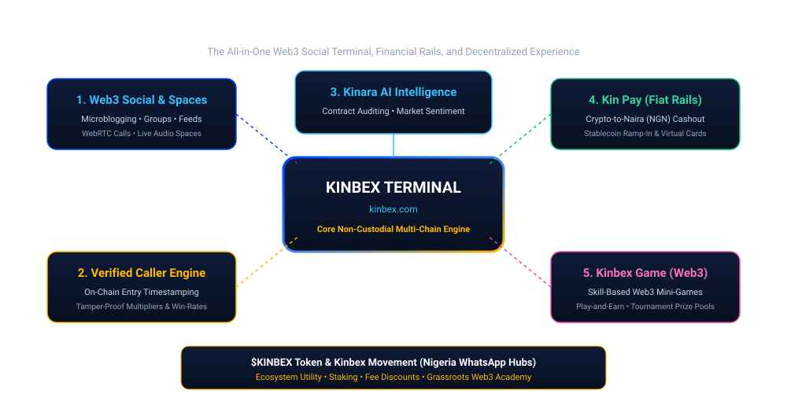
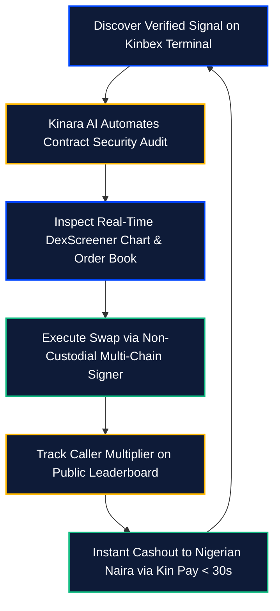

# The Unified Super-Terminal

[← Previous: The Web3 Operational Dilemma](01-fragmentation-dilemma.md) | [Next: Competitive Matrix →](03-competitive-matrix.md)

---

## 1. Introducing KINBEX

**KINBEX** is the all-in-one Web3 social super-terminal and decentralized financial operating system built on `kinbex.com`. Engineered as a sovereign, single-page responsive terminal, Kinbex consolidates every dimension of the active Web3 trader's lifecycle into an interconnected runtime.

---

## 2. The Core Pillars of Unification

Kinbex synthesizes five operational domains into a unified client experience:

### 2.1 Verified Alpha Caller Leaderboard
An automated telemetry pipeline that captures on-chain entry timestamps, locks baseline liquidity pool prices, and calculates real-time peak multipliers ($M$) and Dynamic Caller Scores ($DCS$). Unverifiable claims and deleted calls are mathematically impossible.

### 2.2 Institutional Market Telemetry
Native DexScreener candlestick feeds, dynamic order-book streams, pair liquidity analytics, and volume breakdown charts rendered directly adjacent to social discussion threads.

### 2.3 Web3 Social & Communication Grid
High-velocity micro-blogging, community owner monetization channels, token-gated alpha groups, and peer-to-peer WebRTC voice/video calls featuring a persistent floating picture-in-picture overlay.

### 2.4 Kinara AI On-Chain Co-Pilot
A conversational artificial intelligence engine embedded into the trading viewport that automates bytecode decompilation, honeypot detection, sentiment scoring, and portfolio risk management.

### 2.5 Kin Pay Financial Rails & African Gateway
Direct fiat-to-crypto and crypto-to-fiat conversion infrastructure providing sub-30-second automated bank settlements into Nigerian Naira (NGN), stablecoin ramp-in rails, and global crypto-funded virtual Visa/Mastercard cards.

### 2.6 Kinbex Game Studio & Competitive Protocol
An integrated Web3 entertainment layer featuring lightweight, skill-based mini-games executed in-terminal with non-custodial smart contract prize pools.

---

## 3. High-Velocity Trader Flywheel


**Eliminating App Switching:**  
By consolidating the full stack into `kinbex.com`, traders maintain full execution velocity without exposing private keys or shifting contexts between fragmented applications.

