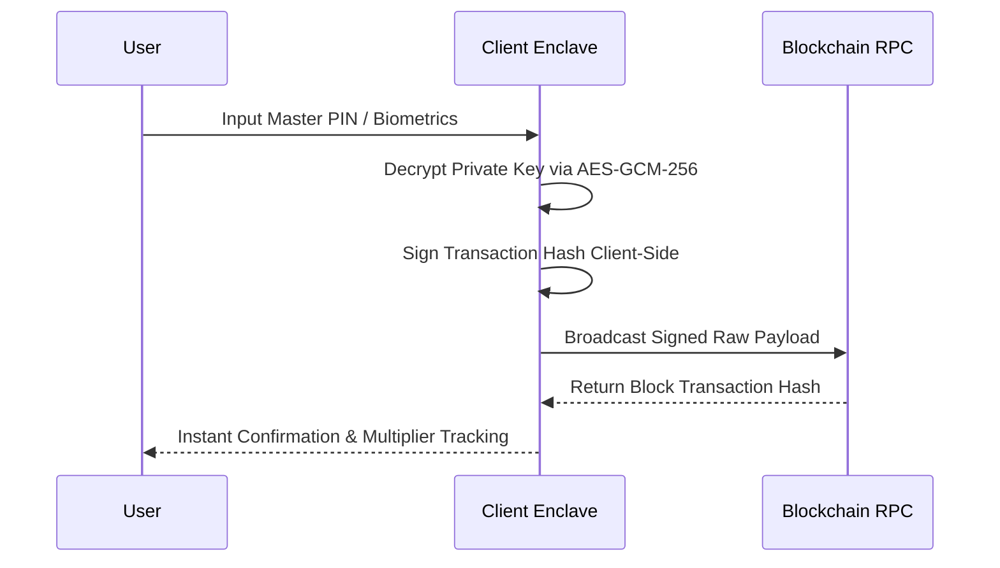

# Client Runtime & Enclave

[← Previous: Competitive Matrix](../01-protocol-thesis/03-competitive-matrix.md) | [Next: Telemetry & Data Fabric →](02-telemetry-and-data-fabric.md)

---

## 1. Technical Stack Overview

Kinbex is engineered as a zero-install, single-page responsive terminal accessible globally via `kinbex.com`. The front-end architecture is optimized for high-frequency trading telemetry and synchronized social interaction.

```
┌─────────────────────────────────────────────────────────────┐
│                    KINBEX CLIENT ARCHITECTURE               │
├─────────────────────────────────────────────────────────────┤
│  Presentation: React 18 Concurrent + TanStack Router        │
│  Design Tokens: Tailwind CSS + Radix UI Primitives          │
│  State Management: TanStack Query + WebSocket Synchronizer   │
│  Cryptographic Vault: WebCrypto API (AES-GCM-256)            │
│  Communications: WebRTC Mesh + DTLS/SRTP Media Rails        │
└─────────────────────────────────────────────────────────────┘
```

### 1.1 Core Technologies
* **Presentation Layer:** TanStack Router combined with React 18 concurrent rendering, providing seamless micro-page transitions without full browser reloads.
* **Component Design System:** Tailwind CSS paired with Radix UI headless primitives and Lucide icons, styled in the signature Kinbex **Electric Cobalt (`#0047FF`)** and **Radiant Gold (`#FFB800`)** color palette.
* **State & Data Synchronization:** TanStack Query client-side cache coupled with dedicated WebSocket workers, handling up to 10,000 tick updates per second without UI stutter.

---

## 2. Sovereign Cryptographic Key Enclave

Kinbex enforces strict non-custodial custody. Unlike custodial exchange terminals or Telegram bots, user credentials and seed phrases are never transmitted across the network.

### 2.1 Client-Side Key Generation & Encryption
* **Entropy Generation:** Cryptographically secure pseudorandom numbers generated via the browser `window.crypto.getRandomValues` WebCrypto API.
* **Symmetric Encryption:** Private keys and mnemonic seed phrases are encrypted using **AES-GCM-256** with unique initialization vectors (IVs) derived via PBKDF2 with 100,000 iterations.
* **Multi-Chain Signing Support:**
  * **EVM Chains:** Ethereum, BNB Chain, Base, Arbitrum (secp256k1 curves).
  * **Solana:** Ed25519 high-velocity transaction signing.
  * **TON:** Telegram Open Network multi-chain signer.




**Zero Server Knowledge:**  
At no point do Kinbex servers, backend APIs, or database clusters hold, log, or store unencrypted user private keys. Loss of device access requires the user to restore their wallet using their offline seed phrase.

