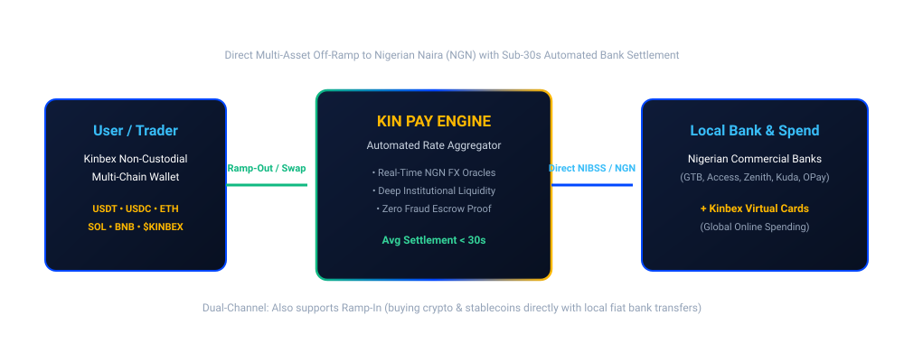

# African Liquidity Gateway

[← Previous: Sentiment NLP Co-Pilot](../04-kinara-ai-intelligence/03-sentiment-nlp-co-pilot.md) | [Next: Sub-30s Fiat Settlement Engine →](02-sub-30s-fiat-settlement.md)

---

## 1. The Emerging Market Liquidity Paradox

Emerging economies—led by **Nigeria, Kenya, Ghana, and South Africa**—consistently demonstrate the highest per-capita grassroots cryptocurrency adoption globally. Faced with high inflation, local currency devaluation, and restrictive foreign exchange quotas, millions of citizens actively trade cryptocurrency as a store of value and wealth-generation tool.

However, traditional banking systems frequently restrict direct cryptocurrency transactions, creating a critical bottleneck: **traders can win in the market, but cashing out into real-world purchasing power is painful and perilous.**

```
┌────────────────────────────────────────────────────────┐
│             TRADITIONAL P2P OFF-RAMP FRICTION          │
├────────────────────────────────────────────────────────┤
│  • P2P Desk Counterparty Risk & Fraudulent Chargebacks │
│  • Bank Account Freezes & Regulatory Scrutiny          │
│  • Severe Spreads (Up to 5% to 8% lost in conversion)  │
│  • Settlement Times Extending From 15 Min to Hours     │
└────────────────────────────────────────────────────────┘
```

---

## 2. Introducing Kin Pay

**Kin Pay** is the dedicated fiat-crypto bridge built directly into the Kinbex ecosystem. Engineered as an institutional-grade liquidity and clearing rail, Kin Pay eliminates the risks and delays of informal peer-to-peer desks.



---

## 3. Core Capabilities of Kin Pay

* **Direct Crypto-to-Fiat Cashout:** Instant conversion of major digital assets (USDT, USDC, ETH, SOL, BNB, and $KINBEX) directly into local commercial bank accounts.
* **Instant Nigerian Naira (NGN) Rails:** Automated settlement via official interbank settlement rails (NIBSS / Instant Clearing) delivering cash to Nigerian bank accounts in under 30 seconds.
* **Frictionless Ramp-In:** Direct local fiat bank deposits enabling users to purchase stablecoins and tokens into their non-custodial wallet without P2P escrow disputes.
* **Institutional Liquidity Aggregation:** Routing transactions through regulated liquidity providers and market makers to provide razor-thin spreads and transparent FX oracle rates.
* **Global Virtual Debit Cards:** Issuing crypto-funded virtual Visa and Mastercard cards for frictionless international e-commerce and subscription spending.


**Grassroots Empowerment:**  
Kin Pay bridges decentralized on-chain profits directly into real-world local economic utility, providing millions of African traders with reliable financial sovereignty.

