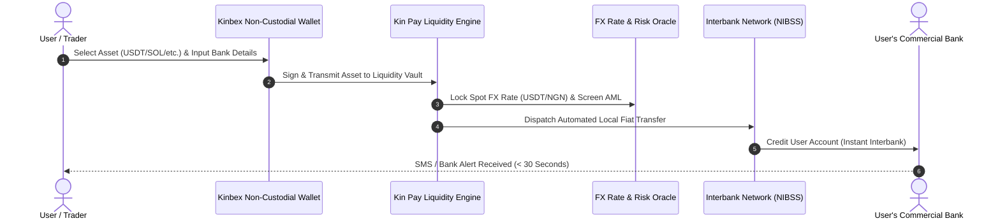

# Sub-30s Fiat Settlement Engine

[← Previous: African Liquidity Gateway](01-african-liquidity-gateway.md) | [Next: Virtual Debit Card Rails →](03-virtual-card-infrastructure.md)

---

## 1. Automated Clearing Sequence

The core innovation of Kin Pay is the complete automation of the off-ramp lifecycle. When a user requests an instant cashout to their local bank, the clearinghouse executes a sub-30-second workflow:

---

## 2. Supported Nigerian Banking Network

Kin Pay provides native settlement coverage across the entire Nigerian financial ecosystem:

### 2.1 Tier-1 Commercial Banks
* Guaranty Trust Bank (GTBank)
* Access Bank Plc
* Zenith Bank Plc
* United Bank for Africa (UBA)
* First Bank of Nigeria

### 2.2 Digital Challenger & Mobile Payment Banks
* Kuda Bank
* OPay
* Moniepoint MFB
* Palmpay
* VFD Microfinance Bank

---

## 3. FX Rate Aggregation & Zero-Spread Exploitation

Traditional P2P platforms suffer from artificial merchant markup where sellers charge 5% to 8% above official market rates.

Kin Pay deploys an **Automated FX Oracle**:
* Aggregates real-time interbank foreign exchange rates and parallel market liquidity depth.
* Executes conversions with institutional spreads under $1.0\%$.
* Zero escrow disputes: transactions are handled by automated liquidity reserves rather than individual human counter-parties who might stall or fail to release funds.

---

## 4. Dual-Sided Ramp-In (Fiat to Crypto)

Kin Pay equally functions as a direct on-ramp:
1. User requests a crypto purchase (e.g., 50 USDT).
2. Kin Pay issues a unique, one-time automated virtual account number.
3. User transfers local Naira via standard mobile banking app.
4. Upon settlement detection, stablecoins are automatically minted or transferred to the user's non-custodial Kinbex wallet address in under 60 seconds.


**Average Settlement Velocity:**  
Over 95% of Kin Pay off-ramp transactions achieve bank confirmation in under 30 seconds from user authorization.

