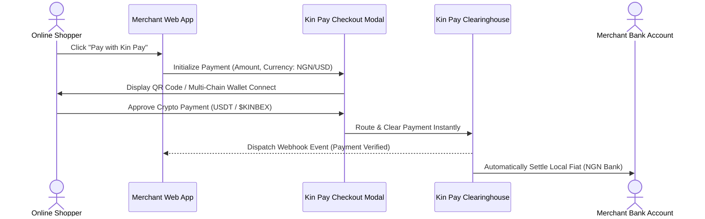

# Merchant Checkout SDK

[← Previous: Virtual Debit Card Rails](03-virtual-card-infrastructure.md) | [Next: In-Terminal WASM Canvas Runtime →](../06-kinbex-game-studio/01-wasm-canvas-runtime.md)

---

## 1. Decentralized Merchant Payment Infrastructure

Kin Pay extends beyond individual trader cashouts by exposing a lightweight, embeddable **Merchant Checkout SDK**. This enables online businesses, digital creators, and regional African merchants to accept cryptocurrency payments while automatically receiving settled local fiat or stablecoins.

---

## 2. Technical Integration Flow

---

## 3. Merchant Benefits

* **Zero Chargeback Risk:** Cryptocurrency transactions are irreversible on-chain, eliminating the friendly-fraud chargebacks common in traditional credit card processing.
* **Instant Fiat Payouts:** Merchants do not need to hold or manage volatile cryptocurrency. Kin Pay can automatically convert payments and deposit local currency into the merchant's corporate bank account.
* **Ultra-Low Merchant Fees:** Transaction fees of $0.5\% - 1.0\%$, significantly lower than the $2.5\% - 4.5\%$ charged by traditional card processors.
* **Discounts for $KINBEX Settlements:** Merchants opting to settle or hold $KINBEX enjoy zero platform fees and promotional marketing across the Kinbex social feeds.


**Developer Simplicity:**  
Merchants can integrate Kin Pay with under 10 lines of JavaScript or use pre-built plugins for Shopify, WooCommerce, and custom web applications.

