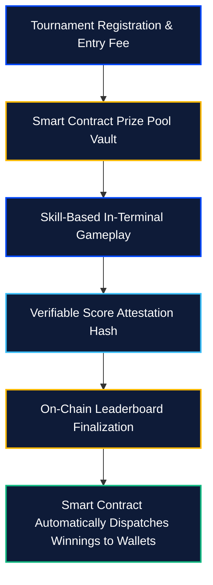

# Provably Fair Prize Distribution

[← Previous: In-Terminal WASM Canvas Runtime](01-wasm-canvas-runtime.md) | [Next: Tournaments & Community Sponsorships →](03-tournaments-and-sponsorships.md)

---

## 1. Non-Custodial Reward Architecture

Traditional online gaming platforms rely on centralized databases where administrators can alter game physics, withhold payouts, or manipulate odds.

Kinbex Game implements a **non-custodial, smart contract-governed reward model**:

* **Automated Prize Vaults:** Tournament buy-ins and sponsorship liquidity are locked into immutable on-chain smart contracts.
* **Instant Wallet Settlements:** Upon tournament conclusion, winnings and jackpots are routed directly into the player's non-custodial wallet without requiring manual withdrawal approval from platform administrators.
* **Zero Operator Tampering:** The platform never has custody of prize funds; smart contracts automatically release tokens according to provable leaderboard rankings.

---

## 2. Provably Fair Cryptographic Entropy

For mini-games requiring random events (e.g., item drops, obstacle generation, card shuffles), Kinbex utilizes verifiable on-chain entropy:

* **Commit-Reveal Schemes:** Players and the game engine exchange cryptographic hashes before game execution, ensuring neither party can predict or manipulate random variables.
* **Verifiable Random Function (VRF):** High-stakes tournament jackpots leverage decentralized VRF oracles to guarantee tamper-proof outcomes that can be audited publicly on-chain.


**Transparent Jackpots:**  
Every participant can verify the total prize pool, active player count, and exact distribution percentage directly on the blockchain explorer.

