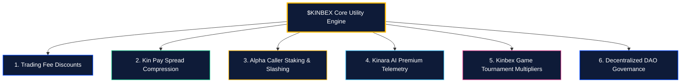

# Utility Matrix & Fee Discounts

[← Previous: $KINBEX Token Architecture](01-kinbex-token-specification.md) | [Next: Caller Staking & Slashing Dynamics →](03-caller-staking-and-slashing.md)

---

## 1. Six Ecosystem Utility Pillars

The utility architecture of $KINBEX is organized across six operational pillars:

---

## 2. Utility Specifications

### 2.1 Trading Fee Reductions
Traders holding or paying swap fees in $KINBEX receive tiered reductions on terminal routing fees:

| Holding Tier | $KINBEX Balance | Swap Fee Discount | Kinara AI Daily Limit |
| :---: | :---: | :---: | :---: |
| **Tier 0** | $0$ | $0\%$ | 10 Scans / Day |
| **Tier 1** | $1,000$ | $15\%$ | 50 Scans / Day |
| **Tier 2** | $5,000$ | $35\%$ | Unlimited Basic Scans |
| **Tier 3** | $25,000$ | $60\%$ | Unlimited + Real-Time Whale Alerts |
| **VIP Tier** | $100,000$ | **$80\%$ Discount** | Full Decompiler + VIP Priority Relays |

### 2.2 Kin Pay Cashout Benefits
Staking $KINBEX compresses conversion spreads on crypto-to-Naira (NGN) off-ramp and ramp-in transactions, maximizing the fiat amount deposited into the user's bank account.

### 2.3 Kinara AI Premium Intelligence
Unlocks deep contract de-compilation, real-time smart-money mempool alerts, wash-volume cluster maps, and automated portfolio rebalancing.

### 2.4 Kinbex Game Boosts
Grants free entry into daily sponsored prize tournaments and provides staking multipliers on tournament payouts.


**Value Accrual Mechanism:**  
As trading volume and Kin Pay cashout velocity expand, token demand increases directly with platform usage.

