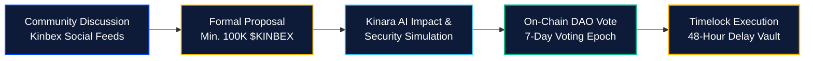

# Protocol DAO Governance

[← Previous: Caller Staking & Slashing Dynamics](03-caller-staking-and-slashing.md) | [Next: African Expansion Strategy →](../08-grassroots-movement/01-african-expansion-strategy.md)

---

## 1. Staged Decentralization Framework

The Kinbex protocol adheres to a progressive decentralization roadmap. While initial engineering velocity requires core team leadership, governance authority will progressively transition to the **Kinbex Decentralized Autonomous Organization (DAO)**.

---

## 2. Governance Scope & Voting Domains

$KINBEX token holders will exercise binding voting power across key protocol operational parameters:

* **Kin Pay Currency Expansion:** Voting on priority sovereign currencies to integrate (e.g., Kenyan Shilling - KES, Ghanaian Cedi - GHS, South African Rand - ZAR).
* **Protocol Treasury Allocations:** Steering grants for third-party developer integrations, community educational cohorts, and security bug bounties.
* **Fee Parameter Tuning:** Adjusting baseline DEX swap routing fees, staking lock durations, and caller slashing thresholds.
* **Gaming Prize Allocations:** Directing protocol liquidity towards seasonal tournament prize pools and game developer incubators.

---

## 3. Proposal Lifecycle & Governance Flow

### 3.1 Proposal Threshold
To prevent spam, submitting a formal improvement proposal (KIP - Kinbex Improvement Proposal) requires staking a minimum threshold of $100,000 \text{ \$KINBEX}$.

### 3.2 Timelock Safeguards
All approved governance actions pass through a 48-hour programmatic timelock contract, allowing users to review smart contract upgrades before deployment.


**Community Sovereignty:**  
DAO governance ensures that the Kinbex terminal evolves to serve the collective interests of its active trader and caller base.

