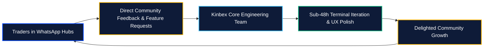

# WhatsApp Academy Flywheel

[← Previous: African Expansion Strategy](01-african-expansion-strategy.md) | [Next: Global Multi-Channel Network →](03-global-syndication-network.md)

---

## 1. Grassroots Education on the Frontlines

Technological innovation without grassroots education fails. In Nigeria and across the African continent, everyday social coordination, commerce, and community bonding occur primarily on **WhatsApp**.

Recognizing this cultural reality, the **Kinbex Movement** operates active, structured educational cohorts directly inside WhatsApp community hubs.

---

## 2. The WhatsApp Academy Curriculum

The Kinbex Movement delivers free, high-impact Web3 training cohorts designed to take newcomers from zero knowledge to confident, self-sovereign traders:

```
┌────────────────────────────────────────────────────────┐
│             KINBEX ACADEMY TRAINING MODULES            │
├────────────────────────────────────────────────────────┤
│  Module 1: Wallet Security, Seed Phrases, & Phishing   │
│  Module 2: Fundamental & Technical Candlestick Analysis│
│  Module 3: Using the Kinbex Terminal & VAE Callers     │
│  Module 4: Kinara AI Contract Auditing & Honeypot Scans│
│  Module 5: Kin Pay Cashouts: Direct NGN Bank Transfers │
└────────────────────────────────────────────────────────┘
```

### 2.1 Live Interactive Audio Classes
Community tutors and guest market analysts host scheduled evening voice sessions, walking students through live charts, risk management principles, and position sizing.

### 2.2 Scam Defense & Antivirus Mindset
Students are rigorously trained to identify drainer links, fake bot groups, impersonation scams, and rug-pull signatures before risking capital.

---

## 3. Direct Engineering Feedback Loop

The Kinbex WhatsApp hubs function as an immediate telemetry channel connecting active traders with the core engineering team:




**Join the Movement:**  
Access to official Kinbex WhatsApp cohorts is coordinated via the [Official Community Admin Link](https://chat.whatsapp.com/kinbex).

