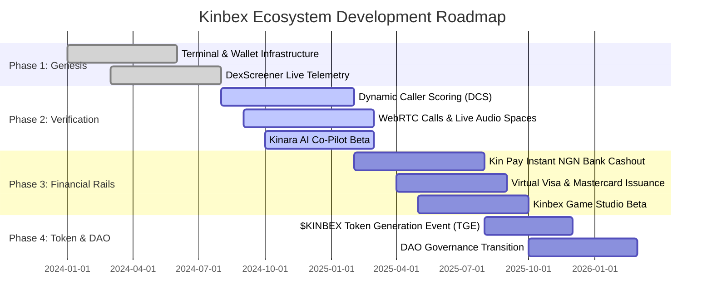

# Multi-Phase Protocol Roadmap

[← Previous: Anti-Manipulation Safeguards](02-anti-manipulation-controls.md) | [Next: Official Verification Directory →](../10-reference-and-governance/01-official-verification-registry.md)

---

## 1. Phased Architecture & Execution Strategy

The development and deployment of the Kinbex super-terminal follows a structured four-phase roadmap balancing rapid engineering execution with rigorous security verification.

---

## 2. Protocol Roadmap Phases

---

### Phase 1: Genesis & Core Terminal Architecture (Completed)
* Deploy core responsive terminal on `kinbex.com` utilizing TanStack Start, React 18, and Tailwind CSS.
* Integrate DexScreener live candlestick charts and real-time order-book telemetry.
* Launch sovereign, non-custodial multi-chain wallet infrastructure with local key encryption.
* Implement Web3 social micro-blogging, user profiles, and community creation modules.

### Phase 2: Alpha Caller Verification & Real-Time Comms (Current)
* Deploy automated on-chain entry-point tracking and the Dynamic Caller Score ($DCS$) calculation core.
* Launch WebRTC floating voice/video calls with persistent picture-in-picture overlay.
* Launch interactive token-gated Live Audio Spaces.
* Deploy Kinara AI co-pilot for real-time bytecode decompilation, honeypot scanning, and market intelligence.
* Expand the **Kinbex Movement** educational academy on WhatsApp across Nigeria and West Africa.

### Phase 3: Kin Pay Financial Rails & Kinbex Game (Upcoming)
* Public release of **Kin Pay**: Direct crypto-to-Naira (NGN) instant bank settlements in under 30 seconds.
* Launch automated local currency ramp-in (buying crypto via bank transfer).
* Launch **Kinbex Virtual Debit Cards** (Visa and Mastercard) for frictionless online global spending.
* Beta release of **Kinbex Game Studio** featuring skill-based mini-games and smart contract prize vaults.
* Expand Kin Pay local currency settlement rails into Kenya (KES), Ghana (GHS), and South Africa (ZAR).

### Phase 4: Token Generation Event (TGE) & Ecosystem Decentralization (Future)
* Formal smart contract deployment and comprehensive third-party security audits for the $KINBEX token.
* Launch $KINBEX staking, fee discounts, caller economic bonds, and reward distribution engines.
* Open the **Kin Pay Merchant Checkout SDK** for African and international e-commerce platforms.
* Transition core protocol governance parameters to the decentralized Kinbex DAO.


**Continuous Delivery:**  
Roadmap milestones are updated dynamically as smart contract audits, regulatory approvals, and liquidity partnerships are confirmed.

