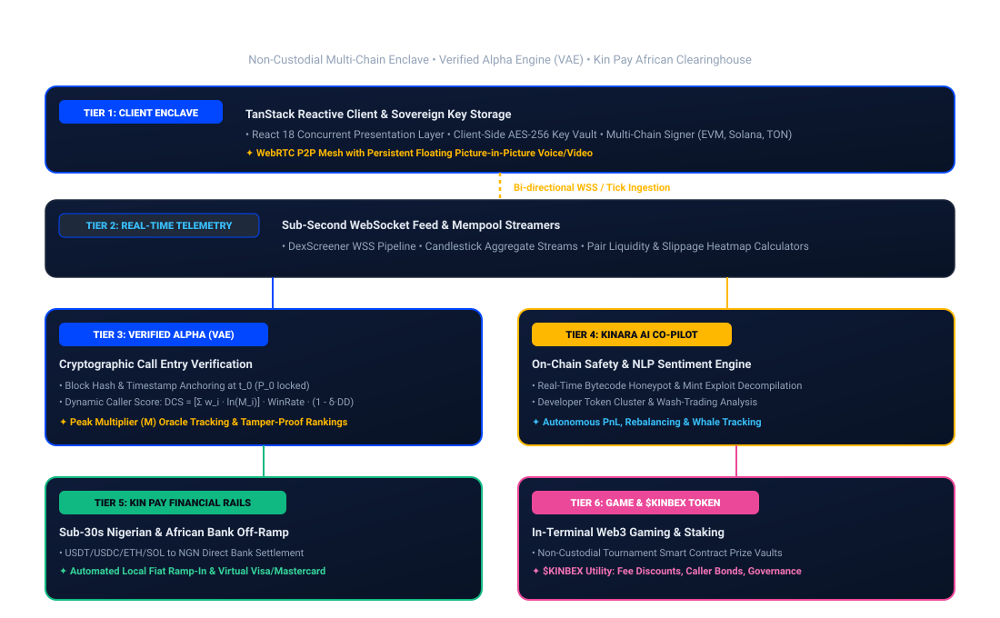

# KINBEX MASTER TECHNICAL WHITEPAPER
### The Unified Web3 Social Terminal, Alpha Verification, Kin Pay Financial Rails, & Gaming Ecosystem

---

## Protocol Metadata & Release Status

| Parameter | Specification |
| :--- | :--- |
| **Document Version** | `3.0.0-PROD` |
| **Canonical Domain** | [kinbex.com](https://kinbex.com) |
| **Token Event Status** | In Development / Smart Contract Finalization (Official Launch to be Announced) |
| **Classification** | Comprehensive Technical Architecture & Ecosystem Specification |
| **Primary Brand Palettes** | Electric Cobalt (`#0047FF`) & Radiant Gold (`#FFB800`) |

---

## Executive Summary

Decentralized finance (DeFi) and Web3 community coordination are constrained by severe ecosystem fragmentation. Today, the typical trader and crypto enthusiast must run multiple disjointed applications simultaneously:

1. **Social & Sentiment Feeds:** Centralized networks (X/Twitter, Telegram, Discord) with no cryptographic validation.
2. **Telemetry & Real-Time Charting:** Third-party charting portals (DexScreener, Birdeye, TradingView).
3. **Execution & Custody:** Non-custodial browser extensions and decentralized exchanges (Uniswap, Raydium, PancakeSwap).
4. **Alpha Discovery & Verification:** Unverified influencer calls, doctored profit-and-loss screenshots, and unvetted group recommendations.
5. **Real-World Liquidity & Cashout:** Disjointed P2P desks, exorbitant off-ramp spreads, and fragmented regional payment rails, especially across emerging economic hubs like Nigeria and Africa.

**KINBEX** is the all-in-one Web3 social super-terminal and decentralized financial operating system built on `kinbex.com`. Kinbex unifies:

* **Verified Caller Leaderboard:** Cryptographically verifiable entry-point tracking, peak multiplier calculations, and tamper-resistant win-rate rankings.
* **Institutional Market Telemetry:** Live candlestick charting, order-book feeds, and real-time pair monitoring powered by DexScreener feeds.
* **Web3 Social Hub:** High-velocity micro-blogging, community owner monetization, token-gated content, and direct messaging.
* **Real-Time Communication:** Direct peer-to-peer WebRTC voice/video calls with global floating overlays, and multi-user Live Spaces.
* **Kinara AI:** An on-chain conversational market intelligence co-pilot.
* **Kin Pay Financial Rails:** Direct crypto-to-fiat conversion, instant Naira (NGN) bank settlements, stablecoin ramp-in/ramp-out, and global virtual cards.
* **Kinbex Game:** An integrated Web3 gaming ecosystem with skill-based mini-games, play-and-earn mechanics, and tournament leaderboards.
* **$KINBEX Token Architecture:** Core utility, fee reductions, caller staking, and governance.

---

## High-Throughput System Topology

The diagram below outlines the five operational tiers powering the Kinbex super-terminal:

---

## Master Navigation Matrix

To explore the full specification, proceed to the following sections:

| Part | Section | Focus Area |
| :---: | :--- | :--- |
| **I** | [Protocol Thesis](01-protocol-thesis/01-fragmentation-dilemma.md) | The Web3 operational dilemma, terminal unification, and competitive benchmarking. |
| **II** | [System Architecture](02-system-architecture/01-client-runtime-and-enclave.md) | Client-side cryptographic enclave, telemetry streaming, and WebRTC grid. |
| **III** | [Verified Alpha Protocol](03-verified-alpha-protocol/01-signal-entry-cryptography.md) | Multiplier mathematics, Dynamic Caller Score ($DCS$), and Sybil resistance. |
| **IV** | [Kinara AI Intelligence](04-kinara-ai-intelligence/01-bytecode-safety-scanner.md) | Real-time bytecode decompilation, liquidity auditing, and social NLP. |
| **V** | [Kin Pay Financial Rails](05-kin-pay-financial-rails/01-african-liquidity-gateway.md) | Sub-30s Nigerian Naira bank clearing, virtual debit cards, and merchant APIs. |
| **VI** | [Kinbex Game Studio](06-kinbex-game-studio/01-wasm-canvas-runtime.md) | In-terminal Web3 micro-games, provably fair smart contract pools, and tournaments. |
| **VII** | [Tokenomics & Incentives](07-tokenomics-and-incentives/01-kinbex-token-specification.md) | $KINBEX token utility, fee discounts, caller bonds, and DAO steering. |
| **VIII** | [Grassroots Movement](08-grassroots-movement/01-african-expansion-strategy.md) | Sub-Saharan Web3 adoption, WhatsApp academy flywheel, and global community hubs. |
| **IX** | [Security & Roadmap](09-security-and-compliance/01-threat-modeling-and-keys.md) | Cryptographic guarantees, anti-manipulation controls, and multi-phase milestones. |
| **X** | [Reference & Governance](10-reference-and-governance/01-official-verification-registry.md) | Canonical links, verification directory, and regulatory compliance notices. |

---


**Official Terminal Access:**  
The Kinbex terminal is accessible globally at [kinbex.com](https://kinbex.com). Always verify domains and SSL certificates before connecting Web3 wallets or executing financial operations.

