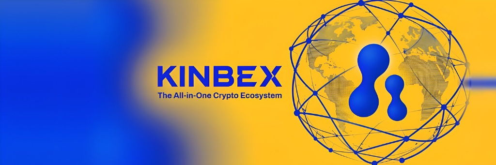

<div align="center">



# KINBEX MASTER TECHNICAL WHITEPAPER
### The Unified Web3 Social Terminal, Alpha Verification, Kin Pay Financial Rails, & Gaming Ecosystem

[](https://kinbex.com)
[](https://kinbex.com)
[](https://x.com/kinbexapp)
[](https://github.com/youngcrypton/kinbex)

</div>

---

## Executive Summary

Decentralized finance (DeFi) and Web3 community coordination are constrained by severe ecosystem fragmentation. Active market participants must constantly context-switch across 4 to 6 separate applications—discovering tokens on social feeds, checking contract safety on scanners, analyzing charts on DexScreener, executing swaps on decentralized exchanges, and navigating high-risk informal P2P desks to off-ramp proceeds into local fiat.

**KINBEX** is the sovereign Web3 super-terminal built on `kinbex.com` that unifies the entire lifecycle into a single, high-throughput runtime:

1. **Verified Alpha Engine (VAE):** Cryptographically verifiable entry-point timestamping, peak multiplier tracking, and tamper-resistant Dynamic Caller Score ($DCS$) rankings that eliminate fraudulent profit claims.
2. **Institutional Market Telemetry:** Sub-second candlestick streaming, depth-of-market feeds, and pair analytics powered by direct WebSocket pipelines.
3. **Web3 Social Feed & Live Spaces:** Micro-blogging, token-gated alpha channels, creator tipping, and direct peer-to-peer WebRTC voice/video calls with global floating picture-in-picture overlays.
4. **Kinara AI Co-Pilot:** On-chain conversational intelligence delivering real-time bytecode decompilation (honeypot/mint exploit detection), liquidity auditing, and social sentiment scoring.
5. **Kin Pay Financial Rails:** Direct crypto-to-fiat bridge delivering instant Nigerian Naira (NGN) commercial bank settlements in under 30 seconds, stablecoin ramp-in/ramp-out, and global virtual debit cards (Visa/Mastercard).
6. **Kinbex Game Studio:** In-terminal Web3 gaming ecosystem with provably fair prize distributions and community-sponsored tournaments.
7. **$KINBEX Token Architecture:** Core utility coordination, swap fee discounts, caller bond staking, and Protocol DAO steering.

---

## High-Throughput System Topology

```
┌───────────────────────────────────────────────────────────────────────────┐
│                       TIER 1: CLIENT RUNTIME & ENCLAVE                    │
│   React 18 Concurrent Presentation Layer • Client-Side AES-256 Vault      │
│   Multi-Chain Signer (EVM, Solana, TON) • Floating WebRTC Overlay         │
└─────────────────────────────────────┬─────────────────────────────────────┘
                                      │ Bi-directional WSS / Tick Ingestion
┌─────────────────────────────────────▼─────────────────────────────────────┐
│                    TIER 2: REAL-TIME TELEMETRY FABRIC                     │
│   DexScreener WebSocket Streamers • Candlestick Aggregate Engines         │
│   Mempool Event Listeners • Liquidity & Slippage Depth Calculators        │
└──────────────────┬─────────────────────────────────────┬──────────────────┘
                   │                                     │
┌──────────────────▼─────────────────┐ ┌─────────────────▼──────────────────┐
│  TIER 3: VERIFIED ALPHA ENGINE     │ │   TIER 4: KINARA AI INTELLIGENCE   │
│  Block Hash & Price at t_0 Locked  │ │   Real-Time Bytecode Decompilation │
│  Peak Multiplier Oracle Tracking   │ │   Automated Honeypot / Mint Audits │
│  Dynamic Caller Score (DCS) Engine │ │   NLP Social Sentiment Scoring     │
└──────────────────┬─────────────────┘ └─────────────────┬──────────────────┘
                   │                                     │
┌──────────────────▼─────────────────────────────────────▼──────────────────┐
│                   TIER 5: KIN PAY SETTLEMENT & GAMING RAILS               │
│   Sub-30s Nigerian Naira (NGN) Instant Bank Settlement (NIBSS Engine)     │
│   Global Crypto Virtual Cards • WASM Canvas Web3 Gaming Tournaments       │
└───────────────────────────────────────────────────────────────────────────┘
```

---

## Master Whitepaper Navigation

The complete specification is organized into 10 structured sections (31 technical chapters):

| Part | Section | Core Focus & Chapters |
| :---: | :--- | :--- |
| **I** | [Protocol Thesis](01-protocol-thesis/01-fragmentation-dilemma.md) | [Fragmentation Dilemma](01-protocol-thesis/01-fragmentation-dilemma.md) • [Unified Super-Terminal](01-protocol-thesis/02-the-unified-super-terminal.md) • [Competitive Matrix](01-protocol-thesis/03-competitive-matrix.md) |
| **II** | [System Architecture](02-system-architecture/01-client-runtime-and-enclave.md) | [Client Runtime & Enclave](02-system-architecture/01-client-runtime-and-enclave.md) • [Telemetry Fabric](02-system-architecture/02-telemetry-and-data-fabric.md) • [WebRTC & Live Spaces](02-system-architecture/03-real-time-communications.md) |
| **III** | [Verified Alpha Protocol](03-verified-alpha-protocol/01-signal-entry-cryptography.md) | [Signal Entry Cryptography](03-verified-alpha-protocol/01-signal-entry-cryptography.md) • [Mathematical Formalisms & DCS](03-verified-alpha-protocol/02-mathematical-formalisms-dcs.md) • [Anti-Sybil Ranking](03-verified-alpha-protocol/03-anti-sybil-and-ranking.md) |
| **IV** | [Kinara AI Intelligence](04-kinara-ai-intelligence/01-bytecode-safety-scanner.md) | [Bytecode Safety Scanner](04-kinara-ai-intelligence/01-bytecode-safety-scanner.md) • [Liquidity & Volume Audit](04-kinara-ai-intelligence/02-liquidity-and-volume-audit.md) • [Sentiment NLP Co-Pilot](04-kinara-ai-intelligence/03-sentiment-nlp-co-pilot.md) |
| **V** | [Kin Pay Financial Rails](05-kin-pay-financial-rails/01-african-liquidity-gateway.md) | [African Liquidity Gateway](05-kin-pay-financial-rails/01-african-liquidity-gateway.md) • [Sub-30s Fiat Settlement](05-kin-pay-financial-rails/02-sub-30s-fiat-settlement.md) • [Virtual Debit Cards](05-kin-pay-financial-rails/03-virtual-card-infrastructure.md) • [Merchant SDK](05-kin-pay-financial-rails/04-merchant-checkout-sdk.md) |
| **VI** | [Kinbex Game Studio](06-kinbex-game-studio/01-wasm-canvas-runtime.md) | [WASM Canvas Runtime](06-kinbex-game-studio/01-wasm-canvas-runtime.md) • [Provably Fair Distribution](06-kinbex-game-studio/02-provably-fair-distribution.md) • [Tournaments & Sponsorships](06-kinbex-game-studio/03-tournaments-and-sponsorships.md) |
| **VII** | [Tokenomics & Incentives](07-tokenomics-and-incentives/01-kinbex-token-specification.md) | [$KINBEX Token Architecture](07-tokenomics-and-incentives/01-kinbex-token-specification.md) • [Utility & Fee Matrix](07-tokenomics-and-incentives/02-utility-matrix-and-discounts.md) • [Caller Staking & Slashing](07-tokenomics-and-incentives/03-caller-staking-and-slashing.md) • [DAO Governance](07-tokenomics-and-incentives/04-protocol-dao-governance.md) |
| **VIII** | [Grassroots Movement](08-grassroots-movement/01-african-expansion-strategy.md) | [African Expansion Strategy](08-grassroots-movement/01-african-expansion-strategy.md) • [WhatsApp Academy Flywheel](08-grassroots-movement/02-whatsapp-academy-flywheel.md) • [Global Multi-Channel Network](08-grassroots-movement/03-global-syndication-network.md) |
| **IX** | [Security & Roadmap](09-security-and-compliance/01-threat-modeling-and-keys.md) | [Threat Modeling & Keys](09-security-and-compliance/01-threat-modeling-and-keys.md) • [Anti-Manipulation Controls](09-security-and-compliance/02-anti-manipulation-controls.md) • [Multi-Phase Roadmap](09-security-and-compliance/03-protocol-epoch-roadmap.md) |
| **X** | [Reference & Governance](10-reference-and-governance/01-official-verification-registry.md) | [Official Verification Directory](10-reference-and-governance/01-official-verification-registry.md) • [Regulatory & Legal Notices](10-reference-and-governance/02-regulatory-and-legal-notices.md) |

---

## Quantitative Alpha Formula: Dynamic Caller Score ($DCS$)

To guarantee objective, tamper-proof rankings for alpha callers, the protocol evaluates performance through a decay-weighted formula:

$$DCS = \left[ \sum_{i=1}^{N} w_i \cdot \ln(M_i) \right] \times \text{WinRate} \times (1 - \delta \cdot \text{DrawdownRate})$$

Where:
* $M_i = \frac{\max_{t \in [t_0, t_0 + T]} P_t}{P_0}$: The verified peak multiplier tracked by on-chain price oracles.
* $w_i = \exp(-\lambda \cdot (t_{\text{now}} - t_i))$: Time-decay weighting ensuring active accuracy over historical survivorship bias.
* $\text{WinRate} = \frac{N_{\text{win}}}{N}$: Proportion of verified calls reaching or exceeding $2.0\times$ baseline.
* $\delta = 0.25$: Risk dampening parameter penalizing callers whose recommendations experience $>80\%$ drawdowns within 60 minutes.

---

## Official Verification Directory

To prevent impersonation and phishing attacks, always verify links against this registry:

* **Official Terminal:** [https://kinbex.com](https://kinbex.com)
* **Official X (Twitter):** [@kinbexapp](https://x.com/kinbexapp)
* **WhatsApp Movement Academy:** [Official WhatsApp Community Hub](https://chat.whatsapp.com/kinbex)
* **Telegram Official:** [https://t.me/kinbex](https://t.me/kinbex)
* **Discord Community:** [https://discord.gg/kinbex](https://discord.gg/kinbex)

---

<div align="center">
<sub>© Kinbex Protocol Engineering Core. Published for technical coordination, architecture review, and community governance.</sub>
</div>
